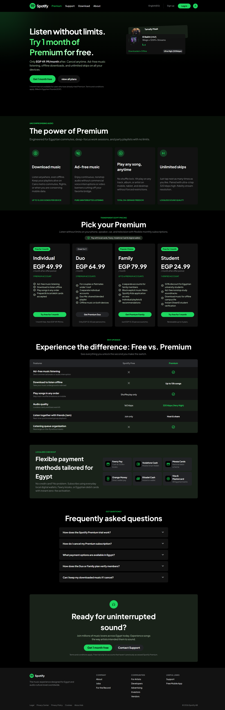
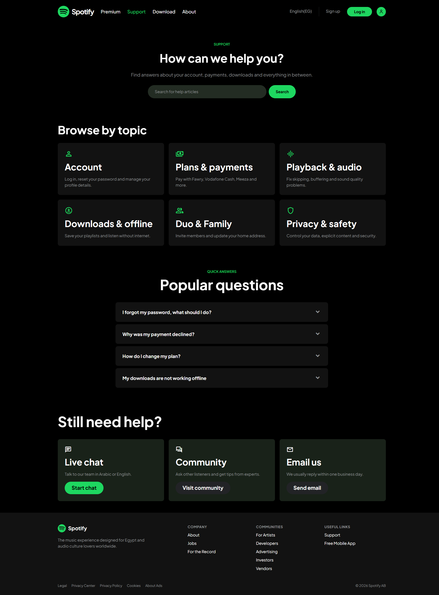
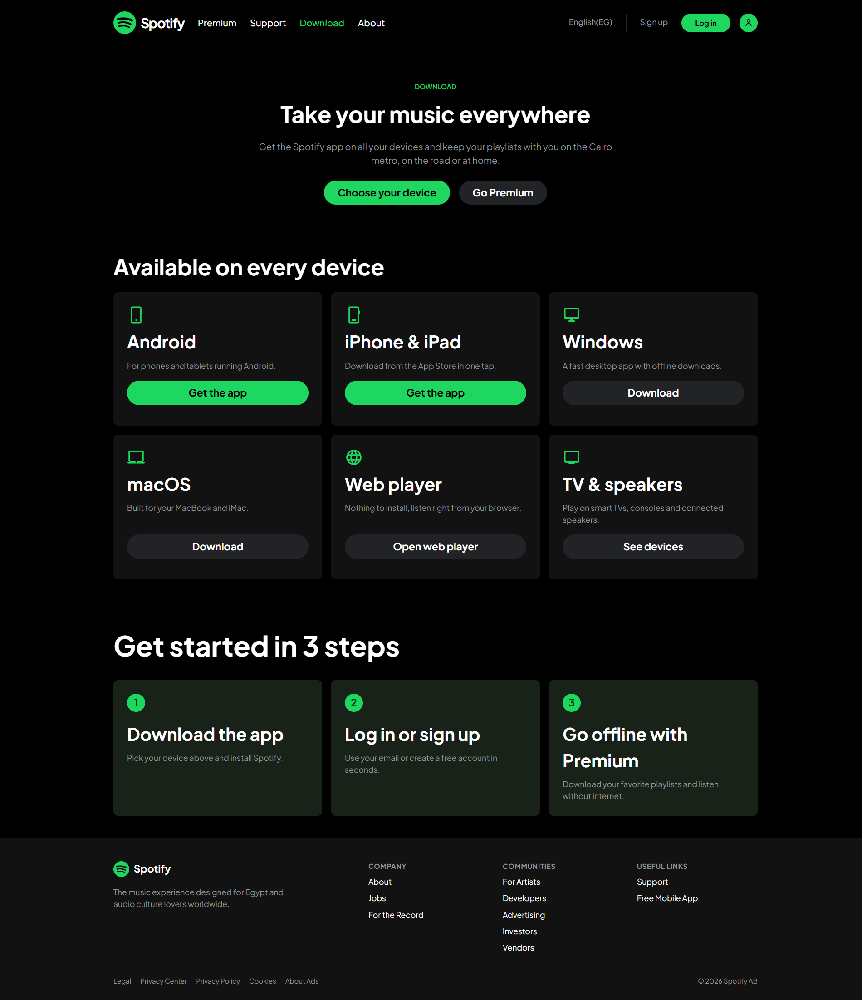
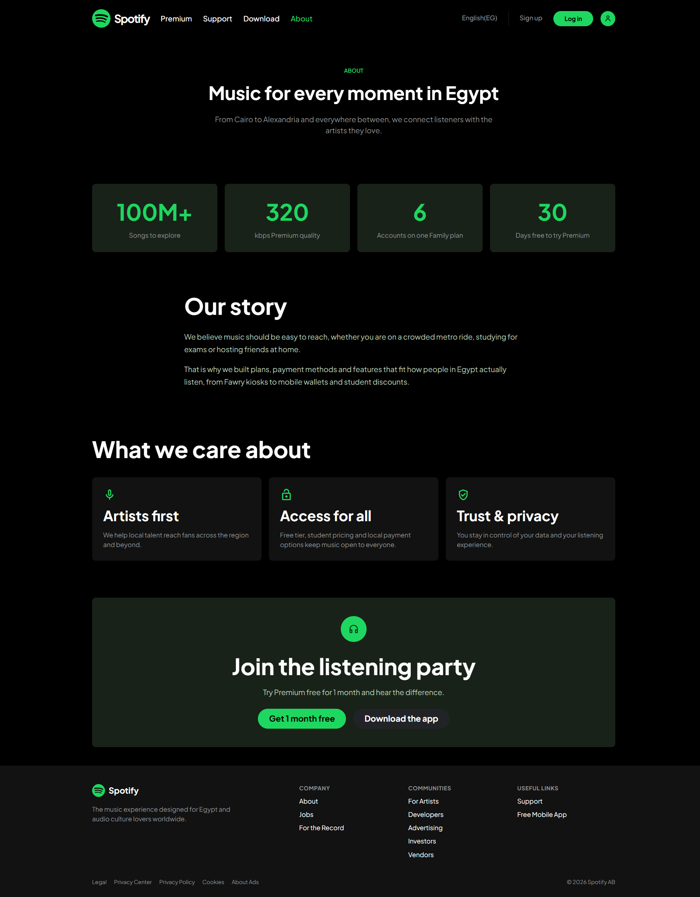

# Spotify Egypt Landing Page

A static, multi-page website concept inspired by Spotify Premium and localized for Egypt. The pages are built with HTML and CSS and adapt to mobile and desktop screen sizes.

## Pages

- **Home / Premium** (`index.html`) — Premium features, plan information, and music highlights.
- **Support** (`support.html`) — Help topics, search, and support contact options.
- **Download** (`download.html`) — App download information for different platforms.
- **About** (`about.html`) — Story and company information.

## Screenshots

 

 

 



## Performance optimizations

- The two prominent Home page images use `loading="eager"` and `fetchpriority="high"` so the browser prioritizes the hero visuals during initial page load.
- Pages preconnect to Google Fonts, allowing the browser to establish connections to the font host earlier.
- The site uses static HTML and CSS without a JavaScript runtime or build step, keeping the page delivery lightweight.
- CSS media queries adapt layouts at defined viewport widths for mobile and larger screens.

## Run locally

No dependencies or build tools are required. Open `index.html` in a browser, or start any static web server in this folder. Use the navigation links to move between pages.

## Project structure

```text
.
├── index.html
├── support.html
├── download.html
├── about.html
├── styles/
│   ├── base.css
│   ├── home.css
│   └── pages.css
├── images/
│   ├── amr-diab.jpg
│   └── wegz.jpg
```

## Built with

- HTML5
- CSS3
- Google Fonts: Plus Jakarta Sans and Material Symbols

Google Fonts are loaded externally, so an internet connection is needed for the remote font styles to appear.
