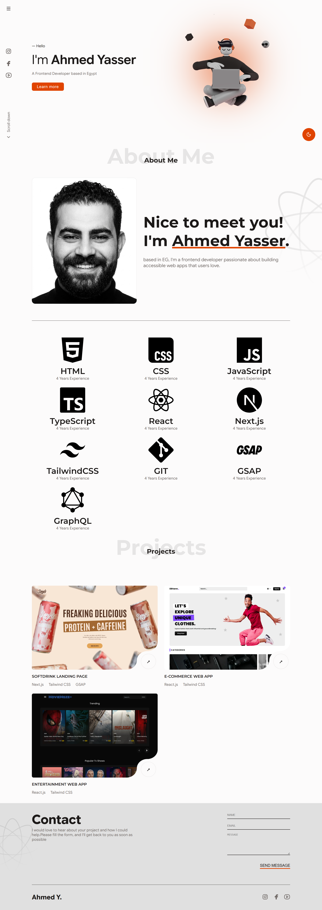
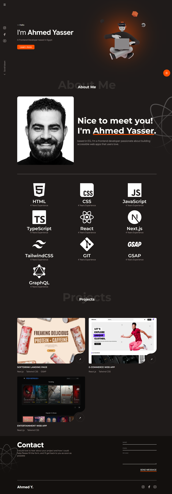

# Ahmed Yasser | Frontend Developer

A responsive personal portfolio built with HTML, CSS, and vanilla JavaScript. It introduces Ahmed, highlights his skills and selected projects, and provides a contact section.





## Features

- Responsive layout for mobile, tablet, and desktop screens
- About, skills, projects, and contact sections
- Collapsible navigation with smooth scrolling to page sections
- Locally stored font files and SVG skill icons
- WebP images for the hero, profile, and project previews

## Performance optimizations

- Preconnects to the Google Fonts asset host to reduce connection setup time.
- Preloads the hero WebP image and marks it high priority so it can be fetched early.
- Loads the hero image eagerly with high fetch priority because it appears above the fold.
- Uses lazy loading and low fetch priority for below-the-fold profile, skill, and project images.
- Serves raster images as WebP to reduce image transfer size.
- Uses `font-display: swap` for locally defined fonts so text can render before font files finish loading.

## Run locally

No build step or package installation is required. Open `index.html` in a browser, or serve this folder with any static file server.

## Project structure

```text
.
├── assets/
│   ├── icons/       # Skill icons
│   └── images/      # Portfolio, profile, and project images
├── fonts.css        # Local font-face declarations
├── index.html       # Page structure and content
├── script.js        # Navigation and theme interaction logic
└── style.css        # Layout, responsive styles, and visual design
```
