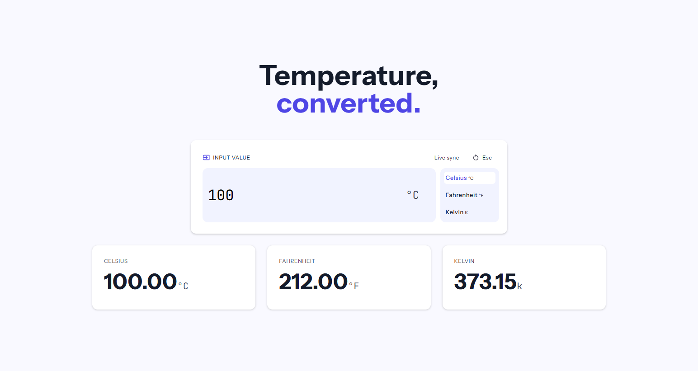
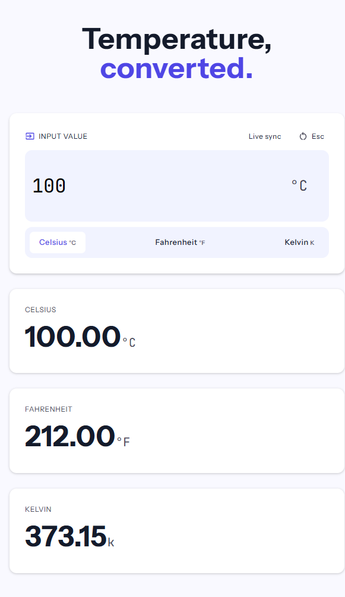

# Temperature Converter

A responsive, browser-based temperature converter built with HTML, CSS, and vanilla JavaScript. Enter a temperature, choose its unit, and see the equivalent values in Celsius, Fahrenheit, and Kelvin update live.

## Features

- Converts between Celsius, Fahrenheit, and Kelvin.
- Updates all three results as you type or change the selected unit.
- Validates numeric input and temperatures below absolute zero.
- Press **Esc** or use the reset control to clear the input and results.
- Responsive layout for desktop and mobile screens.
- No dependencies, build tools, or server required.

## Run locally

1. Clone or download this repository.
2. Open `index.html` in a modern web browser.

The app runs entirely in the browser. No installation or build command is needed.

## Project files

- `index.html` — page structure and converter controls.
- `global.css` — layout, styling, and responsive rules.
- `fonts.css` — bundled font-face declarations.
- `script.js` — conversion, validation, and reset behavior.
- `assets/icons/` — interface icons.
- `screenshots/` — location for project screenshots.

## Screenshots

 

## Temperature formulas

- Celsius to Fahrenheit: `°F = (°C × 9/5) + 32`
- Celsius to Kelvin: `K = °C + 273.15`
- Fahrenheit to Celsius: `°C = (°F − 32) × 5/9`
- Fahrenheit to Kelvin: `K = (°F − 32) × 5/9 + 273.15`
- Kelvin to Celsius: `°C = K − 273.15`
- Kelvin to Fahrenheit: `°F = (K − 273.15) × 9/5 + 32`

Results are displayed to two decimal places. Temperatures below absolute zero are rejected.
